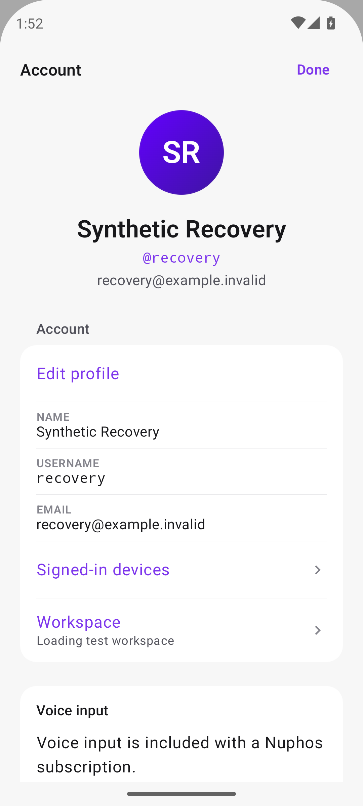
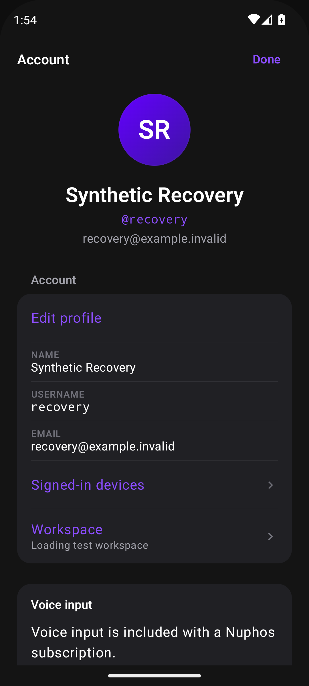
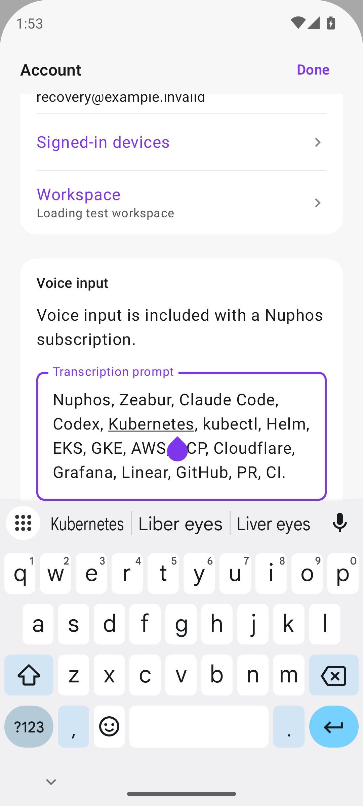
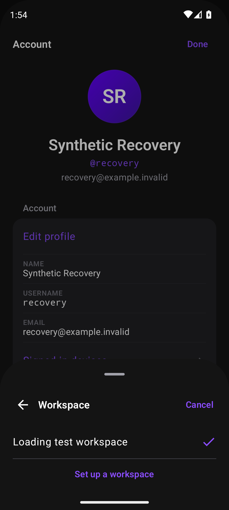
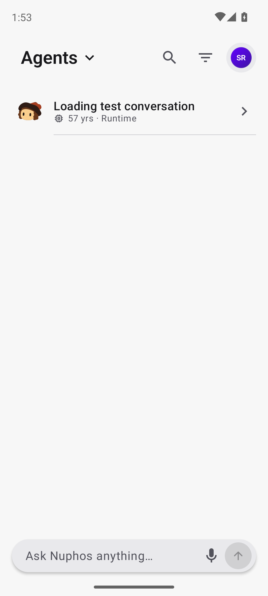

# Account handle verification

Production source `5f6d858288a8d73ada61e49b306ca6c84c883e10` adds `dragHandle = null` only to the outer Account modal. The nested Workspace sheet retains its handle. Modal presentation and dismissal gestures are otherwise unchanged.

Normal Root, minified/resource-shrunk non-debuggable synthetic build: light and dark Account show no handle; Done and settled system Back close to Agents. Content scroll and prompt keyboard/IME behavior retain the header and insets. The first Back key injected immediately after opening preceded the sheet settling; a key after settling closed normally. No product failure is inferred from that automation timing.

Lint and R8 build passed. Separate package and test signature with localhost API; DEBUG is true solely for the local API guard. No MainActivity override, production account, physical device, private screenshot, Play upload or merge. Artifact hash in result.json.
