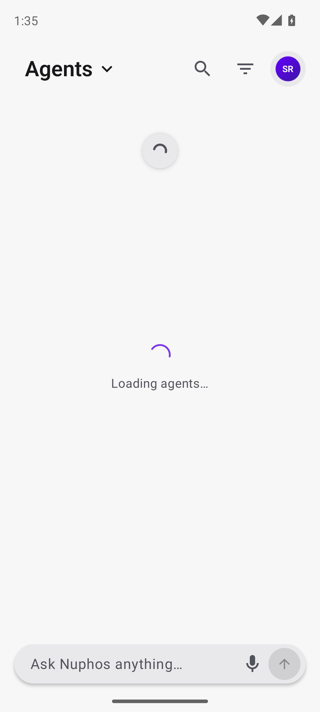
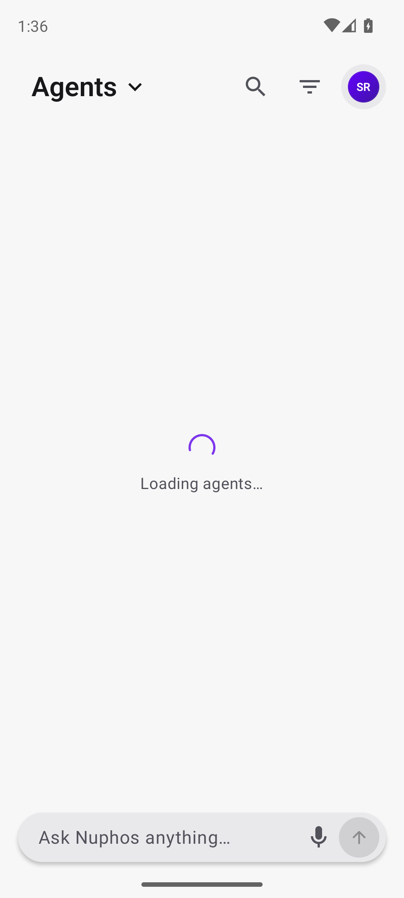
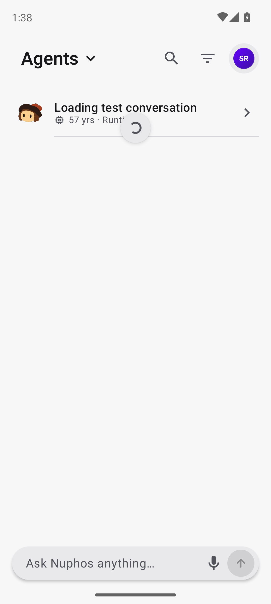
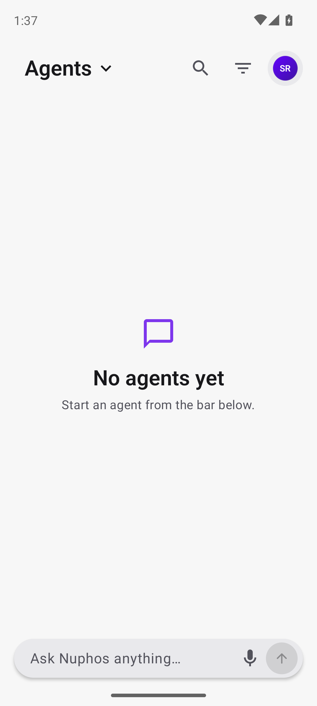
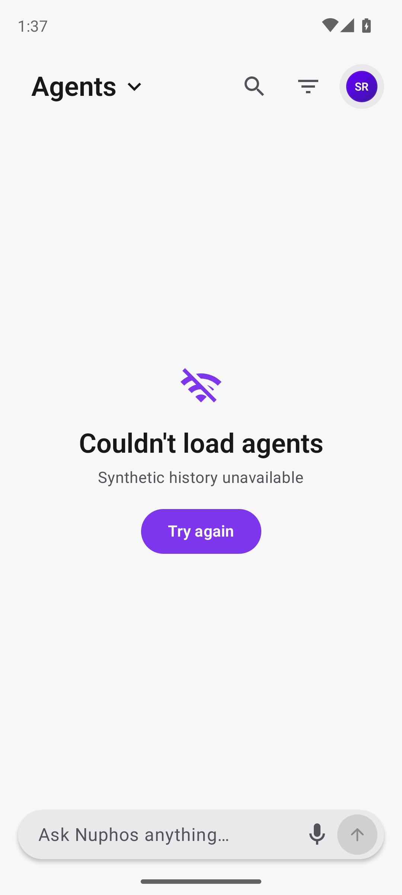
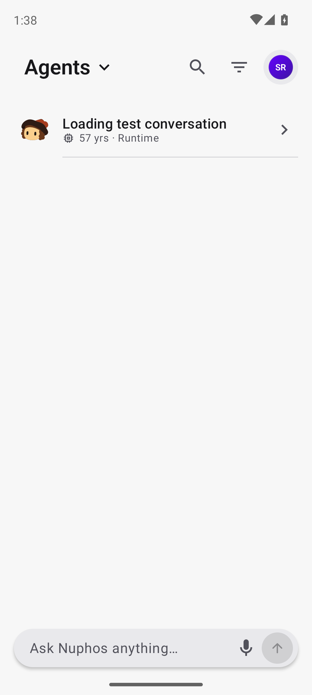

# Agents initial-loading indicator verification

Production source: `5748c14aca7dd3763f2e906a03830e57e4fefc35`, based on `42cdec16887a9f18fb1b0dbbe28fcad95a6bf92f`.

A normal Root build with an isolated package and test signature reproduced two indicators during delayed initial history loading. The same delayed response with the fix shows only the centered indicator. Already loaded rows remain visible during pull refresh and returning from detail, with the top indicator retained. Empty history and synthetic HTTP 503 retain their normal UI; Try again restores the list.

| Before | After |
|---|---|
|  |  |

467 JVM tests passed with zero failures/errors/skips; lint and both R8/resource-shrunk APK builds passed. The actual AgentPage fixture holds the initial history request while refresh is active, asserts one progress indicator, and verifies recovery to rows. Fixture run: 13/14 passed; the first case timed out waiting for composition before interaction and passed on isolated rerun. The added regression passed in the class run.

The test build is non-debuggable and uses normal Root/Activity; DEBUG is true only to allow the localhost API. No actual service, physical phone, private account, Play upload or production data was used. Artifact hashes and exact acceptance limits are in result.json.
